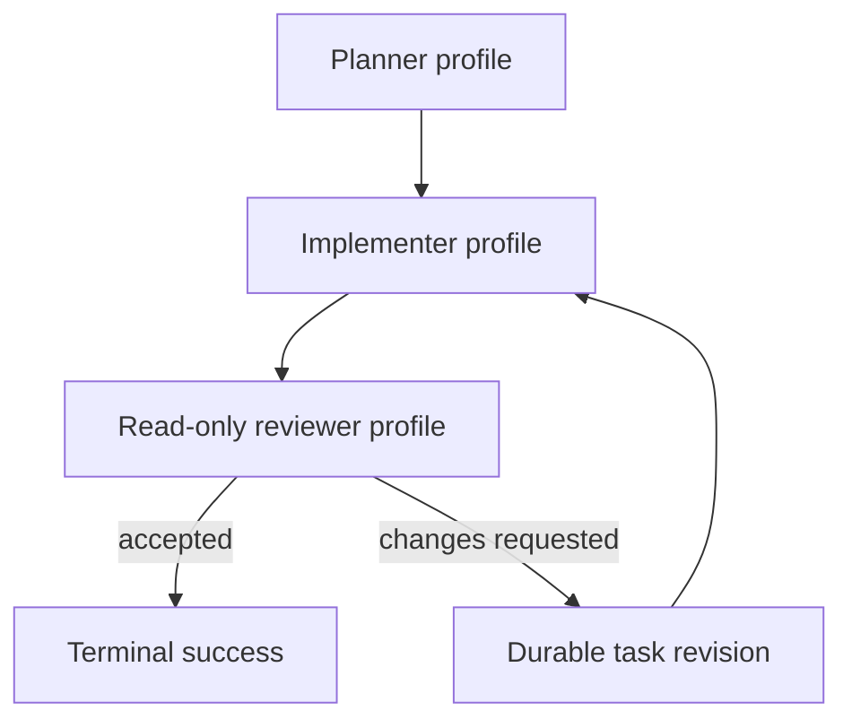

# Dogfood development pipeline plan

Status: **planned**

Last updated: 2026-11-20

Evidence baseline: `6b2ed6263efc8ec990dd6218c02b1434e702bf91`

## Purpose

Build a development pipeline that can safely work on `opencode-docker`, including
the orchestrator and pipeline definitions themselves. The pipeline must use
different execution profiles for planning, implementation and review, carry the
accepted run plan into the worker data plane, support real revision iterations,
and finish with the existing explicit Project Apply operation.

The current browser UI remains a diagnostic/operator surface until this pipeline
has completed a realistic dogfood UAT. UI design follows observed operator work;
it does not lead the backend work.

## Evidence from the proof-only audit

The proof-only audit at the evidence baseline established the following facts:

| Capability | As found |
| --- | --- |
| Different profile per agent state | Available |
| Different LLM server and model per profile | Available |
| Durable model/profile configuration identity | Missing; only the profile name is durable |
| Accepted task revision reaches the stage worker | Missing |
| Stage/plan/task/iteration context reaches the worker | Missing |
| Durable reviewer decision | Available |
| Operator-driven `continue-stage` / `revise-task` loop | Available |
| Automatic task-revision loop | Missing |
| Hard read-only reviewer workspace | Missing |
| General multi-task/multi-stage scheduler | Not ready |
| Pipeline definition frozen for an active run | Available |
| Profile definition frozen for an active run | Missing |
| Current browser UI can drive existing manual boundaries | Available, but diagnostic |

The decisive data-plane failure is that accepted plan and task revisions are
durable but worker-invisible. In the audit reproduction both stage activations
read the original protected pipeline input even after `revise-task`; the
`REVISION-ONE` and `REVISION-TWO` bodies existed only in run-plan manifests.

## Target topology



The first useful pipeline deliberately supports one active task in one stage.
General task scheduling and arbitrary stage DAG execution are later work.

## Architectural decisions

1. **Profiles are semantic pipeline references.** Pipeline states refer to
   `architect`, `code` and `review` profiles. Deployment configuration binds
   those profiles to worker images, OpenCode configuration, providers, models,
   servers and credentials. Pipeline documents do not contain server URLs,
   credential paths or secrets.

2. **The active run remains frozen.** Pipeline identity continues to be bound by
   the execution snapshot digest. Applying a change to pipeline source must not
   alter the active run.

3. **The development pipeline is separate.** Keep `pipelines/default-v2/` as a
   minimal smoke/reference bundle. Add a separate development bundle only after
   the required runtime contracts exist.

4. **Project Apply remains explicit.** A terminal run never updates the registered
   project automatically. Review and Apply remain separate operator decisions.

5. **Hard filesystem authority is required for review.** Prompt instructions or
   OpenCode permissions do not constitute a read-only boundary.

6. **No implicit task selection.** The first stage-task data source is valid only
   when the selected stage has exactly one task. Zero or multiple tasks fail
   closed before a worker Session. This increment must not grow into a scheduler.

7. **UI work is deferred.** Record UI defects and workflow friction during UAT,
   but do not redesign the UI before the development pipeline has been exercised.

## Ordered increments

| Order | Increment | Status |
| ---: | --- | --- |
| 1 | Durable stage activation context | Complete (b63c4cf; CI 42043441341) |
| 2 | Durable profile/model epoch | Complete (8e304bf; CI 42242433550 — build evidence, not test evidence) |
| 3 | Hard read-only reviewer | Complete (9863be3 + a37fe9f + 1fb634c; CI 42621186802; live UAT 2026-11-09) |
| 4 | Separate development pipeline bundle | Complete (3c7caa1; CI 42831456815 — build evidence; bundle contract proven by the permanent suite, no live UAT required) |
| 5 | Real dogfood UAT with revision and Apply | Incomplete with attempts |
| 6 | UI model and implementation based on UAT evidence | In progress — IA accepted; prerequisites P-3 (afe57ca; CI 43466470183), P-1 (abf95e5; CI 43903686912) and P-2 (9b08980 + corrective 00422ee; CI 44103077865 / 44113220025) landed and Complete; UI slices S1–S3 Complete (see their records below) and S4 Complete (7f79b43 → 451e63b → 47adeb50; CI 45370189214 / 45376514804 / 45397965027); the S5 prerequisite S5-P0 is landed and Complete (d0a9e4c + b0d1abe; CI 45603562120 / 45638353441 — see its record below); UI slice S5 is landed at f4f4918 (CI 45665448794) pending its completion record; UI slice S6 — the read-only plan-and-tasks slice — is landed and Complete (9760b14 → 03bf57b → f107e02; CI 45874583269 / 45970265843 / 45986117926 — see its record below); UI slices S7–S8 not started |

Drift-control record (2026-11-12): the plan contains no formal Complete-gate
for an increment's successor. Per explicit operator decision, Increment 6 is
permitted to proceed while Increment 5 is incomplete-with-attempts, provided
the Increment 5 final state and the carried findings below are recorded in
this file before dependent implementation begins (this commit is that
record).

Do not combine adjacent increments merely because they touch the same runner or
state schema. Each increment needs its own red-before evidence, contract,
permanent tests and delivery report.

## Increment 1: durable stage activation context

### Goal

Make the current accepted task revision and content-free orchestration identity
part of the exact worker-visible stage activation.

### Pipeline contract

Add one explicit data-port source form, provisionally:

```yaml
inputs:
  - id: task
    source:
      stage_task: {}
```

The final spelling may change during implementation if an existing source
vocabulary has a better fit, but the following semantics are fixed:

> Implementation note (2026-11-05): the provisional spelling
> `stage_task: {}` was kept; it is now a compiled source form of schema v2
> (`PipelinePortSourceStageTask`), valid only on an agent state whose compiled
> execution role is `stage`, with derived type `file`. The binding is durable:
> run-state schema v11 carries an optional `stage_task` field on agent
> executions (`task_id`, `task_revision`, `task_manifest_sha256`,
> `body_sha256`), recorded by `agent_data_prepared`. The schema bump was chosen
> because the worker-visible bytes digest had no durable anchor before this
> increment — the existing activation input binding proved only accepted
> outputs, not the stage-task input — so the durable-state rule below resolved
> to "schema bump required". The resolver is the single owner in
> `orchestrator/src/pipeline_v2_stage_task.ts`; failures carry the typed
> `stage_task_invalid` reason. Delivered in b63c4cf (CI run 42043441341);
> see the acceptance criteria below for the evidence mapping.

- valid only on an agent state whose trusted execution role is `stage`;
- the task is resolved only from the trusted accepted plan and current durable
  generation/stage context;
- no HTTP, UI, CLI or worker caller supplies a task ID, revision or path;
- the selected stage must contain exactly one task;
- zero tasks or multiple tasks produce a typed failure before Session creation;
- the worker-visible file is the exact UTF-8 byte encoding of the task revision's
  `body`, not the JSON task manifest;
- the input is published through the existing activation-data substrate and
  mounted read-only;
- the binding identifies at least task ID, task revision, task-manifest digest and
  digest of the exact worker-visible bytes;
- task body content does not enter `state.json`, public projections or
  diagnostics.

The execution document gains deterministic content-free orchestration metadata
sufficient to identify the activation:

- plan revision and plan digest;
- stage ID, position and template;
- task ID, revision and manifest digest;
- generation index;
- iteration index.

Previous results, reviewer feedback, profile identity, budget policy, reviewer
filesystem authority, Apply and UI are outside this increment.

### Durable-state rule

Reuse the existing immutable activation input binding if it can prove the exact
task revision and worker-visible bytes after restart. Add a versioned state field
and schema bump only if the existing durable substrate is insufficient. Do not
add duplicate digest or parser ownership merely to create a new schema version.

### Red-before

The permanent red-before must reproduce the observed production behavior:

1. task revision 1 contains `REVISION-ONE`;
2. the first stage activation receives the original pipeline input instead;
3. `revise-task` creates task revision 2 containing `REVISION-TWO`;
4. the next stage activation still receives the original pipeline input;
5. neither execution document contains stage/task/revision/iteration identity.

> Reproduced (2026-11-05) on baseline `68f902b` with a temporary harness that
> drove the real runner over a fake Docker Helper transport; both parts (the
> stale pipeline input on both stage activations, and the compile rejection of
> the new source form) were captured red before the implementation. The
> harness was removed after the permanent suites went green.

### Acceptance criteria

- before revision, the stage worker sees the exact bytes of
  `REVISION-ONE`;
- after `revise-task`, the next stage worker sees the exact bytes of
  `REVISION-TWO`;
- the selected task identity is recoverable and reverified after process restart;
- missing, substituted, non-canonical or digest-divergent task manifests fail
  before Session creation;
- missing or modified activation input artifacts fail closed;
- zero-task and multi-task stages fail before Session creation;
- a non-stage state cannot declare the source form;
- no caller-controlled filesystem path reaches the resolver;
- task bodies remain absent from durable state, public HTTP/UI documents,
  content-free errors and argv;
- existing pipeline-input and state-output source forms retain their behavior;
- no new event kind, UI surface, Apply behavior or profile-binding behavior is
  introduced.

Evidence (b63c4cf): the acceptance criteria are covered by the two permanent
suites — `orchestrator/tests/pipeline_v2_stage_task.test.ts` (compile and
resolver contract, binding mismatches, content-free diagnostics, WeakMap
isolation) and `orchestrator/tests/pipeline_v2_stage_task_runtime.test.ts`
(the real production runner and `revisePipelineV2Task` over a fake Docker
Helper transport: both stage activations receive the exact revision bytes,
the orchestration context appears in both execution documents without the
body, the durable binding is written exactly once per stage execution and
survives the restart boundary, multi-task and worker-tampered-input
refusals fail before any output acceptance, and the pre-Session
verification seam refuses deleted/modified/substituted artifacts). Local
`bun test` reports the apply/project-lock family as not run/not passed in
this environment (the libc-FFI metadata probe fails identically on the
clean baseline commit); CI build 42043441341 is the delivery evidence.

## Increment 2: durable profile/model epoch

Eliminate silent profile drift between separate mutating invocations.

The durable contract must bind a non-secret execution-profile epoch sufficient
to detect changes to the worker image and effective OpenCode/provider/model
configuration. Secrets and credential values remain outside durable state and
public documents.

Before implementation, choose and document whether the epoch is run-wide or
activation-specific. Either choice must make a post-restart execution's effective
profile identity provable and must reject silent substitution with a typed
failure. Explicit profile rebinding is not part of this increment unless
separately designed.

### Implementation note (2026-11-06): Complete as the durable run-wide profile epoch

The run-wide choice is implemented and documented (`AGENTS.md`, the durable
run-wide profile epoch bullet; `docs/orchestration-workflow.md`). One
`loadProfile` call per unique agent-state profile produces a deep-frozen
`ResolvedProfile` whose content-free identity projection builds the epoch
manifest (`pipeline-v2-profile-config\0`, `pipeline-v2-profile-env-value\0`
and `pipeline-v2-profile-epoch\0` digest domains; secrets never produce a
value digest, presence or length). The manifest is published once at
`<runRoot>/profile-epoch.json` and bound atomically into durable state
(schema v12, mandatory `profile_epoch {digest, profile_count}`). Every
mutating existing-run flow recomputes the epoch from the same loaded snapshot
the runtime factory receives and refuses drift with the typed
`profile_epoch_mismatch` before Launcher auth, Sessions, helper calls,
workers or any durable write. Secret rotation never changes the epoch;
profile rebinding and migrations stay out of scope. The plan was marked
complete only after the production commit `8e304bf` and its CI run
(`images`, success — build evidence, not test evidence).

## Increment 3: hard read-only reviewer

Add an OS-enforced read-only project workspace for reviewer activations while
leaving implementer activations read-write.

Required properties:

- the reviewer cannot modify the workspace through edit tools, shell,
  subprocesses, direct writes, rename/unlink or symlink tricks;
- Tool Session authority must not reintroduce write access;
- the policy is selected only by trusted compiled pipeline metadata;
- callers cannot request broader authority;
- direct write attempts are covered by runtime tests;
- prompt and OpenCode permission settings remain defense-in-depth only.

Do not combine this with reviewer decision semantics; durable agent outputs and
decision states already exist.

### Implementation note (2026-11-09): Complete as the compiled workspace access policy, live-UAT proven

Implemented and documented (`AGENTS.md`, the compiled orchestration metadata and
docker-helper runtime adapter bullets; `docs/orchestration-workflow.md`). A stage
role may declare `workspace_access: read_only` (closed vocabulary,
`pipeline_v2.ts`-owned; absence stays absence and compiles byte-identically);
`compiledWorkspaceAccessFor` is the single effective-policy owner with the single
`read_write` default site and is fail-closed on unknown/non-agent states. The
activation layout, execution document, Session filesystem policies and the worker
`POST /run` mount all report the compiled access; there is no read-only to
read-write fallback. Shipped as `9863be3`, corrected by `a37fe9f` (truthful
logical activation layout) and `1fb634c` (fail-closed resolver for
orchestration-less pipelines); CI run `42621186802` published the
`sha256:bddae3c6…ed75ce` orchestrator image.

Final live UAT (2026-11-09, report
`increment-3-final-uat-report.md` in the exchange outbox): the digest-pinned
orchestrator image ran the bundled-default-shaped UAT pipeline (stage role
declared read-only) through one `orchestrator run` to terminal success against
the real docker-helper 2.3.1 daemon with a real rotated Launcher credential and
real LLM workers (`local/glm53-flash`). Proven live: the Execution Session's
issued snapshot was run-root read-only with the activation outputs read-write
and the project read-only (subsumed by the run-root entry under the daemon's
documented normalization); the Tool Session carried exactly one entry — the
project — read-only, confirmed both by `session show` and by `GET /self` from
inside the worker; `/workspace` and `/pipeline/inputs` were kernel read-only
(bindfs `ro`, `docker_helper_ro_projection_t`) and `/pipeline/outputs`
read-write; a 13-probe write battery (create, overwrite, append, truncate,
read-write open, rename, unlink, mkdir, symlink, hardlink, chmod, and two
subprocess variants) was denied with `EROFS`/`EACCES` on every probe while the
project fingerprint stayed byte-identical; the reviewer's declared JSON output
was accepted through the existing digest/schema chain and published as the run
output; Tool-bearer escalation (`POST /run` with a read-write exposure of the
project) was refused `read_only_root` while the read-only control succeeded and
session management with a Session bearer stayed `unauthorized`; every
orchestrator-created Session was deleted (launcher session list empty after
cleanup) and all UAT trees, credential copies and sessions were removed.

## Increment 4: development pipeline bundle

Add a new bundle, provisionally `pipelines/development-v1/`, without expanding
`default-v2`.

Initial roles:

| State | Profile | Workspace |
| --- | --- | --- |
| Planner | `architect` | As required by the accepted planning contract |
| Implementer | `code` | Read-write |
| Reviewer | `review` | Hard read-only |

The first bundle uses one stage and one task. It must:

- consume the accepted task revision through the stage-task source;
- pass reviewer feedback through declared, digest-bound data ports;
- use the existing operator-driven `continue-stage` and `revise-task`
  controllers;
- reach terminal success only through reviewer acceptance;
- keep Project Apply explicit and post-terminal.

Automatic task rewriting, arbitrary task scheduling and multi-stage progression
remain out of scope.

### Implementation note (2026-11-10): Complete as the separate bundle `pipelines/development-v1/`

Shipped as `3c7caa1` (CI run `42831456815` published the
`sha256:14c7e86a…a42a` orchestrator image; the bundle ships through the existing
`pipelines/**` watch and wholesale `COPY` with no packaging change). The
implemented graph is `plan` (planning, `architect`) → `implement` (stage,
`code`, read-write, `stage_task` delivery) → `review` (stage, `review`,
read-only) → `review_gate` (deterministic decision, stage role) → accepted →
`done` / `changes_requested` → `relay` (stage, read-only, zero I/O) → `replan`
(planning, pointer-only proposal over the durable task ledger) → plan-ready
handoff → next iteration; reserved decision outcomes route to `failed`. The
relay correction is structural: a decision execution can never be the stage-wait
recognizer's last stage agent, so the changes-requested edge routes through a
dedicated stage-role relay agent whose `completed` transition enters the trusted
stage wait. Both planning roles declare `stage_wait {continue_stage,
revise_task}` and `plan_ready {stage_position: 1, initial_budget: 1}`: the fresh
`run` and a successful `orchestrator revise-task` each continue automatically
(plain `resume` is only the crash/restart path). The reviewer emits separate
`verdict`/`feedback` JSON ports — the evaluator validates the fact assignment
fail-closed, so a combined document is impossible — and the run output is the
required `review` JSON from `review.feedback`. The bundle declares only the
profile names `architect`/`code`/`review` and ships no profile definitions.

Contract proven by the permanent suite
`orchestrator/tests/pipeline_development_v1.test.ts` (15 tests through the
production loader and the production runner path over the deterministic
transport): loader/digest contracts (exact state graph, normalized orchestration,
exhaustive decision table, reserved-outcome routing through the engine resolver,
workspace-access matrix, digest sensitivity for the trusted policies, pinned
default-v2 byte-identity) and the full operator chain — accepted success
(revision 35), the changes-requested waiting boundary (revision 41),
`continue-stage` iteration 2 with unchanged task bytes (revision 68), one-command
`revise-task` with the revised stage-task bytes consumed by the next iteration
(revision 79), and both restart seams (a crash between the relay transition and
the wait entry; a revise-task interrupted inside the plan-ready continuation)
recovered by plain `orchestrator resume`. No live-LLM UAT is required for this
increment: the real-LLM behavior of the five prompts and the end-to-end
revise-and-Apply dogfood remain Increment 5's boundary.

## Increment 5: dogfood UAT

Run a real, moderately complex change against `opencode-docker`. The task should
touch production code, tests and documentation, but remain small enough for
manual inspection.

The UAT must traverse:

1. planning with the architect profile;
2. implementation with the code profile;
3. reviewer rejection or an intentional operator revision boundary;
4. a durable task revision;
5. a second implementation iteration that visibly consumes the revised task;
6. reviewer acceptance;
7. terminal success;
8. Project Changes and bounded content review;
9. explicit Project Apply;
10. restart and read-only recovery/inspection of the applied operation.

The scenario must guarantee a second iteration. A first-pass success is not
evidence that the revision loop works.

Capture:

- actual provider/model/profile identity per execution;
- exact task revision consumed by each iteration;
- reviewer filesystem authority;
- session cleanup;
- registered-project fingerprints before review and before Apply;
- UI actions that were unclear, missing or unnecessarily difficult.

### Final state (2026-11-12): Incomplete with attempts

Status is final. Three UAT attempts were launched under the frozen r5
protocol (`uat-inc5-1/2/3`); attempt 4 is excluded as verdict fishing — a
re-roll over unchanged frozen assets would select the convenient outcome of
the combined model implementation/review process, not corrected evidence.
The completion protocol, Project Apply, the A/B verification matrix, the
production commit/push/CI and the whole delivery tail were not executed.

Evidence split from the attempts:

- Proven (durable/verified evidence): plan-ready auto-continuation; stage
  generation/iteration; trusted stage-wait entry; the full revise-task
  revision-2 intervention chain through the CLI; fail-closed failure handling
  at every model deviation; profile/config identity (the durable profile
  epoch verified against config-root digests); the actual reviewer Tool
  session's issued snapshot showing the read-only project.
- Not proven: the live kernel-denial probe of the read-only reviewer during
  an Increment 5 review window; any browser/UI interaction; the Project
  Changes/content review/Apply/recovery live leg; the delivery tail.

## Findings carried from Increment 5

Two findings are record-only here; neither is implemented by this amendment.

**Finding A — non-deterministic task-revision boundary.** The
stage-revision gate is decided by the reviewer's `accepted` /
`changes_requested` verdict over locally-judged partial revisions; identical
frozen inputs through independent implementer/reviewer executions produced
opposite gate outcomes, and the evidence does not isolate reviewer verdict
variability from implementer-output differences. This finding is routed to a
**separate future design increment (no number)**: the preferred policy
direction is a deterministic operator-controlled boundary, but the exact
topology and action contract are **not selected** — the existing wait
contract offers only `continue_stage`/`revise_task` and provides no operator
action that terminally accepts a stage after a deterministic wait, so a
naive rerouting could deadlock; a new durable terminal operator action or a
different completion contract may be required. A **separate preflight is
required** before any design or implementation. This finding sharpens open
decision 1 without resolving it.

**Finding B — browser/UI reachability.** The control-plane HTTP service binds
inside the orchestrator container and docker-helper provides no port
publishing, so the shipped browser UI was never reachable during the UAT
(no browser/UI interaction coverage exists in the Increment 5 evidence).
Browser reachability is the **prerequisite of the Increment 6 baseline
browser exercise**, and therefore blocks the IA design and the
implementation; it does **not** block this amendment. Exactly one read-only
reachability probe of an operator-side forwarder is authorized after this
commit: GET-only surface (`GET /`, `GET /ui/app.js`, `GET /v1/projects`),
no run creation, no mutation routes, no Apply, no UAT-tree changes; a failed
probe stops for review.

## Increment 6: UI after dogfood

Design the operator UI from the dogfood workflow rather than extending the
current debug surface incrementally.

The UI model should be based on the observed primary operations:

- plan and task review;
- current stage/task/iteration identity;
- comparison between iterations;
- reviewer decision and feedback;
- explicit continue/revise actions;
- Project Changes/content review;
- explicit Apply and recovery state.

### Accepted UI architecture (2026-11-13)

The **run-centric operational workbench** from
`increment-6-ui-ia-proposal.md` is accepted as the UI architecture. The
accepted artifact is exactly 783 lines, SHA-256
`b3fa11660282ca1cbc7c90db179a3b40a9fa559e492c299a2e7420872e62a955`
(corrective-pass revision, kept as operator evidence outside the repository;
this entry is a contract summary, not a duplicate of the artifact). The
frozen baseline friction report
(`increment-6-ui-baseline-friction-report.md`) and the reachability probe
report are evidence inputs to it.

Contract essentials:

- the UI renders only fields with an established owner from the artifact's
  field-level source matrix — classes `[E]` (shipped route serves it),
  `[G]` (derivable without ambiguity through a named, permanently tested
  pure derivation) and `[P-k]` (bounded prerequisite projection);
- `[X]`-classified fields have no owner and are therefore REMOVED from the
  UI: they are never computed, guessed or substituted with heuristics, and
  they are not displayed;
- a typed absence/unavailable state is only ever rendered on the authority
  of a field WITH an established owner; `Unavailable in effective
  configuration` is derived from `[E] project_apply == false` (the
  discovery flag), and the Apply disable cause itself stays `[X]` and is
  not displayed (the run-list status filter and proactive busy chips are
  likewise removed);
- P-1 (plan/task revision artifact content), P-2 (accepted reviewer
  output content) and P-3 (durable-identity projection: stage position/
  template, settled roles, task bindings, closure reasons, historical wait
  actions/responses/grant amounts, ledger enumeration, decision records)
  remain **separate bounded prerequisite increments**, each with its own
  preflight — bound to the artifact's digest-domain owners (§4a) — and its
  own review; wire formats are not designed by the IA artifact;
- dependent UI slices S1–S8 cannot start before their named prerequisites
  are landed; S1–S3 are presentation-only over `[E]`/`[G]` fields, S4 adds
  the generic `respond` support, S5–S7's P-2 prerequisite is landed and
  Complete (P-3/P-1 landed earlier), S8 uses only shipped routes;
- generic `respond` for non-reserved declared action IDs is preserved
  (the IA routes by the shipped contract, never narrows to one pipeline;
  the reserved `continue_stage`/`revise_task` ids stay on their dedicated
  endpoints);
- security/authority topology is unchanged: operator-side forwarder
  listening only on loopback `127.0.0.1:<port>`, the container server on
  `0.0.0.0:<same-port>` (not itself the loopback boundary), browser
  Host/Origin authority `127.0.0.1:<port>`, foreign Host/Origin failing
  closed before route parsing.

The first four UI slices S1, S2, S3 and S4 have been built and are
**Complete** (see the S1–S4 records below). The bounded prerequisites
**P-3 (durable-identity projection)**, **P-1 (task/plan revision artifact
content)** and **P-2 (accepted reviewer-output content)** are landed and
**Complete** (see below); the remaining UI implementation (S5–S8) remains
not started. The S5 prerequisite
**S5-P0 (the execution→generation/iteration binding and the
`execution-bindings` projection)** is likewise landed and **Complete**
(see its record below); UI slice S5 itself is landed at `f4f4918`
(CI 45665448794 — the identity + execution-bindings pinned streams,
waiting-anchor section, placement, compare and historical battery) and
awaited its first accepted review together with S6, whose completion
record below records the accepted chain from that base. UI slices S7–S8
remain not started.

### S6 Complete: read-only plan-and-tasks slice (2026-11-27)

The S6 slice is landed and **Complete** after a three-round review chain
whose production verdict is PASS at `f107e02aeff0c86da127f94d61ad5909a24bb079`.

Landing chain and CI (each run success on the exact SHA):

- `f4f4918` — landing base: the S5 lifecycle-history section (its own
  completion record is tracked separately).
- `9760b14` (CI 45874583269) — the S6 slice: the `Plan and tasks` read-only
  section as the second consumer of the versioned identity engine
  (`GET /v1/runs/:runId/identity`), the bounded task-body chunk stream
  (`GET /v1/runs/:runId/tasks/:taskId/revisions/:revision` — request
  default 65536 bytes, one-request wire cap 193536 bytes, retained-buffer
  cap 262144 bytes) and the paged plan projection (over the same identity
  engine's plan/task ledgers).
- `03bf57b` (CI 45970265843) — corrective 1: the retained-cap boundary is
  reachable and honest (truncation declared exactly at the 262144-byte
  boundary, load-more thereafter a closed no-op), and durable task evidence
  is fail-closed over EVERY `stage_task` binding (all-bindings agreement —
  never `.some()`).
- `f107e02` (CI 45986117926) — corrective 2: the cap boundary no longer
  flushes the decoder (a `stream:!terminal` decode; the decoder is
  destroyed without a flush at the cap; only the real wire-terminal chunk
  flushes), so a valid multi-byte UTF-8 sequence split exactly at the
  cap-boundary truncates cleanly — proven red-before at `03bf57b` with the
  permanent viewer pin.

Review rounds recorded by the reviewer: r1 REJECTED (four blockers: the
cap's boundedness, the `.some()` durable binding, evidence-set arithmetic,
the non-green focused gate); r2 REJECTED (the single remaining production
defect: UTF-8 at the cap boundary); r3 (this round) PRODUCTION PASS with
the evidence bundle rebuilt per the three docs corrections (empty tail
artifact replaced by the real end-of-run blocks, the 130-failure
classification corrected to the verified 117 + 10 + 3 split, and the base
inventory note replaced by the exact nine-name delta). The self-verifiable
evidence bundle (`increment-6-s6-evidence.tar.gz`,
`d1a8f3cc…b6ab884`, 25/25 manifest OK) plus the r4 preflight report
(`7c691cdf…`) are retained by the operator.

Verification at `f107e02`: targeted S6 suites plus the shared suites —
boundary suite 7/0, combined S6 band 110/0; `tsc --noEmit` 0 errors;
`git diff --check` clean; no `src/` change across the chain; official
isolated gate (`bun run test`): candidate B is the clean authoritative
run — 4618 pass / 130 fail; candidate A reports the identical totals and
a byte-identical 130-name fail set PLUS one runner bookkeeping line
`2 errors` in its summary block (recorded exactly as: same fail set,
two additional runner errors — the a2/a3 `waitFor timeout` diagnostics of
`control_plane_ui_project_apply.test.ts:114`, whose verbatim blocks exist
in both candidates' full logs). Both fail-name sets are equal to the
recorded clean-base (`f4f4918`, 4510 pass / 130 fail) set — all 130 the
Apply environmental set (117 + 10 + 3; `security.selinux` xattr refusal). No further UI
changed; S7–S8 untouched and not started.

### Prerequisite P-3 landed: durable-identity projection (2026-11-13)

P-3 is delivered as one full-stack read-only surface and marked Complete.

- Production commit `afe57ca` ("pipeline v2: add the read-only durable
  identity projection (P-3)"), CI run `43466470183` — success on the exact
  delivered SHA; delivery report
  `/exchange/outbox/increment-6-p3-delivery-report.md`
  (SHA-256 `fb7239e204bfa1ec5af4ce50ed57b799882cce115fe53be7eb0cbd00b5c4c314`).
- Shipped contract (as accepted in the P-3 preflight r3; not reopened here):
  one composite `GET /v1/runs/:runId/identity` over the 17-route inventory;
  CLI `orchestrator identity`; the 12-kind content-free durable record
  stream over the schema-v7 ledgers with flattened generations/iterations,
  wait actions, decision id lists and the mandatory stage-task binding;
  revision-pinned pagination with the 256 KiB full-document cap;
  path-free CLI/HTTP documents; `stale_snapshot` as the one new request-layer
  reason (409), `invalid_cursor` reusing the existing request-layer 400.
- Verification truth (recorded honestly): P-3 added exactly **29 green
  tests** (32-test projection matrix plus the appended CLI/routing/
  subprocess/HTTP batteries net of fixture edits) and `tsc --noEmit -p .`
  is clean. The local full orchestrator suite is **not green**: it reports
  130 failures, and those same 130 failures fully reproduce on the clean
  parent `6004b0c` run — they are not attributable to P-3. The cause is
  environmental: in the current execution container the filesystem carries
  a SELinux context, so every ordinary file bears a `security.selinux`
  xattr, and the fail-closed Apply metadata probe correctly classifies that
  as `unsupported_metadata`, cascading through the Apply/metadata/lock
  suites. No P-3 code path overlaps that layer.
- Not started (unchanged scope): prerequisites P-1/P-2, the UI
  implementation, live Browser UAT, and Finding A. The accepted P-3
  contract and the accepted IA artifact are not revisited by this record.

### Prerequisite P-1 Complete: task/plan revision artifact content (2026-11-16)

P-1 is delivered as one full-stack read-only surface and marked **Complete**
after the accepted implementation/test review through `abf95e5`. The
delivery chain is four single thematic commits, each with CI success on
its exact SHA:

- `fd4c56f` — the P-1 implementation (module, CLI `task-revision`/
  `plan-revision`, control-plane routing/wire, two HTTP routes, the 19-route
  inventory pin) — CI `43854088076`;
- `ff37fea` — the r3 corrective (closed eight-value producer vocabulary in
  `src/pipeline_v2_content_reasons.ts`; the bounded monotone plan projection
  cursor with page-only materialization; real-owner envelope evidence;
  wire/HTTP/CLI `invalid_options` negative pins) — CI `43870829578`;
- `815df62` — the full-document evidence proof (full top-level CLI documents
  with the trailing LF and full top-level HTTP response documents through the
  shipped request handler; measured 258767 / 258776 / 47749 / 47754 bytes) —
  CI `43877684000`;
- `abf95e5` — the boundary proof (grammar-derived worst-case envelope
  expansion on the exact production serializations: task CLI ≤ 771, task
  HTTP ≤ 780, both ≤ the unchanged 1 024-byte reserve; plan envelope ≤ 1024
  independently per surface with record bytes owned by the page budget;
  `full-surface-boundary` naming) — CI `43903686912`.

All four commits leave this plan untouched; all four are test- or
contract-scoped single commits on a clean tree with `git diff --check`
clean and a byte-identical `bun.lock`. Delivery report:
`/exchange/outbox/increment-6-p1-delivery-report.md`
(SHA-256 `463d62d05d28d41ad8716b2b5b65131906b8951fc23f8c39e36ca5ab6cee333f`,
final; it also records the red-before table, the per-commit test deltas —
base delta +50, 4242 → 4292 — and the retry-scope statement: the bounded
retry exists only inside the boundary-test harness, one initial call plus
up to three retries, four total calls maximum, and is not evidence of
one-shot transport reliability).

- Verification truth (recorded honestly): the local full orchestrator suite
  reports **4303 pass / 130 failures**, and those same 130 failures are
  set-identical to the clean-parent A/B runs in the same environment (exact
  failure-set equality against `e499f30` for the base commit and against
  `815df62` for the boundary-proof commit). The cause is the same
  environmental one as the P-3 record: the container filesystem carries a
  SELinux context, so every ordinary file bears a `security.selinux` xattr
  and the fail-closed Apply metadata probe classifies that as
  `unsupported_metadata`, cascading through the Apply/metadata/lock suites.
  No P-1 code path overlaps that layer. `tsc --noEmit -p .` is clean and the
  `bun.lock` is byte-identical throughout.
- Not started (unchanged scope): the P-2 prerequisite (accepted
  reviewer-output content), every UI slice S1–S8, live Browser UAT, and
  Finding A. The accepted P-1 contract (preflight r2 plus the reviewed r3
  correctives and the boundary-proof correction) is not reopened by this
  record.

### Prerequisite P-2 Complete: accepted reviewer-output content (2026-11-17)

P-2 is delivered as one full-stack read-only surface — the bounded,
digest-bound raw-byte slice of one accepted agent execution output — and
is marked **Complete** after the accepted preflight r4 review, the
implementation commit and the operator corrective. Delivery chain:

- `9b08980e56f21aac8b31536127b2d77fa06a2a63` — the P-2 implementation
  (the private `hashByteLength` framing owner with byte-identical
  `hashBytes`; the typed one-handle streaming helper with open-time
  identity/size linearization; the durable-record selection facade
  `orchestrator agent-output` with the closed 9-value producer
  vocabulary and the shared `PIPELINE_V2_OUTPUT_SLICE_LIMIT_MAX = 262 144`;
  CLI command #19; routing kind `agent_output`; the 20th HTTP route
  `GET /v1/runs/:runId/agent-outputs/:executionIndex/:outputId`) —
  CI run `44103077865` — success on the exact SHA;
- `00422eef9b004dce6347bb7bf0a6deb39669571a` — the operator corrective
  (mandatory wire terminal-page invariant; the `activations`-root
  real-directory gate in the token mint; the exact grammar-derived
  envelope proofs) — CI run `44113220025` — success on the exact SHA.

Both commits leave this plan untouched, are clean-tree commits with
`git diff --check` clean and a byte-identical `bun.lock`. Red-before was
materialized on the clean `5b40780` parent before any source change:
baseline digest literals captured with the pre-refactor
`acceptedOutputDigest`, fixtures straddling the 128 KiB chunk boundary,
and the red run showing exactly the new P-2 test material as red
(everything else in the delta was the documented environmental drift).
Final delivery report:
`/exchange/outbox/increment-6-p2-delivery-report.md`
(SHA-256
`bc8403e58b404234860b9679853b678833f05f0c7b112cfb39d3e96f24a74710`,
including §4b recording the corrective).

- Verification truth (recorded honestly): focused suites green — the
  owner suite 25 tests and 452 tests across the touched
  CLI/routing/wire/HTTP suites; `tsc --noEmit -p .` clean; the
  `bun.lock` byte-identical. The full corrective-branch run is
  **4471 tests, 4339 pass, 132 failures**; this is deliberately NOT
  claimed as a set-identical A/B: 130 of the failures belong to the
  pre-existing SELinux/load environmental families recorded under P-3
  and P-1, and the remaining two are 15-second wall-clock timeouts in an
  untouched signal battery (an isolated rerun of that file passes
  42/42); agent-output failures: zero.
- Closed corrective invariants (per the operator corrective):
  1. a terminal wire chunk (`nextOffset: null`) must reach exactly
     `byteCount` (`offset + returnedByteCount === byteCount`), so an
     offset at the byte count admits only the empty terminal chunk;
  2. the token mint verifies the `<runRoot>/activations` root as a real
     non-symlink directory before the activation leaf (absent →
     `artifact_missing`, symlink/wrong kind → `artifact_modified`), with
     the symlinked-ancestor-inside-the-run-root refusal pinned;
  3. the wire negative battery pins `limit: 0` and the unsafe
     `stateId`/`outputId` identity fields as separate refusals;
  4. the grammar-derived envelope bounds are proven exactly on measured
     production documents: CLI document + LF `350 246`, HTTP body
     `350 254` (payload-free envelopes `718` / `726`;
     `4·ceil(262144/3) = 349 528` payload exactly).
- Not started (unchanged scope): every UI slice S1–S8, live Browser UAT,
  and Finding A. The accepted P-2 contract (preflight r4 plus the
  operator corrective) is not reopened by this record.

### S1 Complete: run rail identity line + capability chip (2026-11-20)

S1 (the run-rail identity line plus the Project Apply capability chip in
the Browser UI runs list) is delivered over the shipped read-only surfaces
(`GET /v1/runs`, `GET /v1/runs/:runId`, `GET /v1/runs/:runId/events`,
`GET /v1/projects`) and is marked
**Complete** after the accepted implementation review plus the operator
corrective demanding a strict timeline-shape gate and an authoritative
run-entry source for the chip.

- Implementation `95de891fde12331a94e8730131eb6dec67d2549f` — CI run
  `44531848737` — success on the exact SHA;
- corrective `29b548ce39462c02d9e763c27c1c10ac45538e7b` ("ui: enforce the
  corrective S1 shape gates (timeline shape owner + authoritative run
  entry)") — CI run `44548172198` — success on the exact SHA. Both commits
  touch UI files and their suites only, leave this plan untouched, and are
  clean-tree commits with `git diff --check` clean and a byte-identical
  `bun.lock`.
- Evidence: implementation report
  `/exchange/outbox/increment-6-s1-implementation-report.md`
  (SHA-256 `0596a59597a1de3be6ee4e8699ff603fe6104003a9ad91734434e5579c991b3e`);
  smoke-failure diagnosis
  `/exchange/outbox/increment-6-s1-smoke-failure-diagnosis.md`
  (SHA-256 `fe98a6988ed40b08c4e9f37a93686d15d6927493538fe247b127b1d989654dcd`).
- Verification truth (recorded honestly, full-run equality is
  deliberately NOT claimed): targeted S1 suites green (35-test
  `ui_rail_identity` suite incl. the 13 corrective shape/authority pins;
  touched `ui_model`/`ui_events_wiring`/`ui_inspect_wiring`/
  `ui_inspect_http` green); focused A/B 528 pass / 9 fail with the
  failure-name set equal to the baseline set; full run 4514 tests,
  4383 pass, 131 failures; `tsc --noEmit` and `git diff --check` clean;
  `bun.lock` unchanged. The run contains **one additional failure name
  relative to the recorded 130-name baseline**, in the pre-existing
  `orchestrator/tests/smoke.test.ts` signal battery (test 7, exact vector
  `b2: expected "session_created", received "worker_running"`). Controlled
  A/B (60 full-file runs per side over `1727a69` vs `29b548c` worktrees)
  proved the whole smoke/lifecycle/state chain byte-identical between the
  two commits: the identical test-name family reproduces on the clean
  base (9 failing runs / 60, incl. the exact `b2 → worker_running` vector
  in base runs i17 and i59), so the failure is **pre-existing, not
  S1-caused** — S1 causality is excluded, while the exact mechanism of
  that 691-vector remains unresolved. The inherited smoke signal/FIFO
  harness instability is not fixed and stays out of S1 scope (separate
  harness finding, not started).
- Not started (unchanged scope): UI slices S2–S8, live Browser UAT,
  Finding A, and the smoke-harness fix. The accepted S1 scope and the
  corrective shape-gate/authority invariants are not reopened by this
  record.

### S2 Complete: worker-logs in-place Load-log affordance (2026-11-20)

S2 (the in-place `Load log` row affordance of the Worker logs section,
served over the shipped read-only logs endpoints only) is delivered and
marked **Complete** after the accepted implementation review plus the
operator corrective that established the descriptor ownership.

- Implementation `7cbfe447f3f7a0f668771784d50f844e2f205218` ("ui: add the
  S2 worker-log row load affordance with the desire-liveness descriptor")
  — CI run `44743285931` — success on the exact SHA; the review then
  found the descriptor-ownership defect (a metadata desire could replace
  a live content descriptor) and one false selection race-pin in the
  test suite.
- Corrective `9a1398a9b740d116ad25bd16483c4f3cd5039c1c` ("ui: give the
  S2 worker-log descriptor a desire-token owner (corrective)") — CI run
  `44753687087` — success on the exact SHA. Both commits touch UI files
  and their suites only, leave this plan untouched, and are clean-tree
  commits with `git diff --check` clean and a byte-identical `bun.lock`.
- Evidence: implementation report (final, including the §6 corrective
  record) `/exchange/outbox/increment-6-s2-implementation-report.md`
  (SHA-256
  `612fa579054f1e7c543b5253895763e1cc62850b09b23d41b26b560072a855ff`,
  291 lines).
- Closed corrective contract (C1/C2/C3): the published request descriptor
  (`requestKind`/`requestExecutionIndex`) is owned by the viewer's
  private desire-liveness registry and derived at every publish — a live
  content desire carries the presentation priority over metadata; a
  metadata desire requested during a content GET stays queued/live
  (the transport's existing arbitration) without replacing
  `content/executionIndex`, so the row keeps the disabled `Loading…`
  affordance through the overlap; every terminal — settle, failure
  (including `applyFailure`), a transport settlement without a result —
  removes its token and re-derives the descriptor from the remaining
  live desires (a content terminal with a live metadata desire yields
  `metadata/null`; the last terminal yields `null/null`); stale and
  superseded callbacks are byte-inert; the ownership tokens stay private
  viewer state and never appear in the published document. The closed
  row-affordance vocabulary is `View` / `Load log` / disabled `Loading…`
  / disabled `Loaded`, derived only from the published viewer state; the
  standalone `logs-next-chunk` control is unchanged.
- Verification truth (recorded honestly): focused S2 suites
  (`ui_worker_logs` + `ui_worker_logs_wiring` + `ui_model` +
  `control_plane_ui_worker_logs`) 161/161 pass; the corrective added
  exactly 8 new tests — 7 in `ui_worker_logs.test.ts` (1 structural
  ownership pin plus 6 reverse-overlap/failure-path pins) and 1
  production-DOM wiring pin in `ui_worker_logs_wiring.test.ts`; the
  existing selection-seam race test was corrected in place to fire the
  actual killed content desire (`desires[1]`) and is therefore not one
  of the new tests. The materialized red-before on the clean S2 base is
  7 fail / 90 pass and refers to the seven new viewer tests; no separate
  red-before claim is made for the new wiring test. `tsc --noEmit`
  clean; `git diff --check` clean; `bun.lock` byte-identical. Full A/B
  against the S2 base commit (candidate tree vs `7cbfe447` worktrees,
  identical environment/bun, concurrent whole-suite runs): base 4534
  tests / 4404 pass / 130 failing names, candidate 4542 tests / 4412
  pass / 130 failing names — the failing-name sets are set-identical and
  every name on both sides sits inside the recorded 130-name environment
  baseline, with no smoke-family name failing on either side this run;
  the cross-side test delta is exactly the 8 new passing S2 tests.
- Not started (unchanged scope): UI slices S4–S8, live Browser UAT,
  Finding A, and the smoke-harness fix. The accepted S2 scope, the
  corrective ownership contract and the row-affordance vocabulary are
  not reopened by this record.

### S3 Complete: Project changes review panel placement (2026-11-23)

S3 (anchoring the inline Project change content review panel inside the
Project changes table, directly behind its change row, without affecting
any other section or request) is delivered and marked **Complete** after
the accepted implementation review plus three operator corrective cycles
(production, evidence, evidence-scope).

- The delivery chain is four single thematic commits, each with CI
  success on its exact SHA; all four touch UI files and their suites
  only (the last two are test-only), leave this plan untouched, and are
  clean-tree commits with `git diff --check` clean and a byte-identical
  `bun.lock`:
  - `6d186bbe9664ed9bdc07a41198c4dc75aa6ed1ba` — implementation — CI
    run `44785209551`;
  - `f4700a50a9667a9234b40ca54ad27d6ade0ec885` — production corrective
    (observation-equality gate + `insertBefore` no-op guard) — CI run
    `45148948514`;
  - `e2e2289faa92bebbb441bafb2a02b30e93ab11c9` — abort/evidence
    corrective (abort-contract test renames, abort assertions) — CI run
    `45163817851`;
  - `d0aa57a5759a6b945e0672280c58a6cb320aba1d` — owner-scoped evidence
    pin (the gate asserted once globally and once inside the
    `placeContentReviewPanel` body) — CI run `45182392460`.
- Evidence: implementation report (final revision)
  `/exchange/outbox/increment-6-s3-implementation-report.md`
  (SHA-256
  `ddae94b340702bee3c9fab01e2abea61fb77726b643e2194e6bd08d87fb469d5`).
- Final contract (as reviewed, not reopened by this record):
  one placement/visibility owner (`placeContentReviewPanel` — park,
  gate, wrap, anchor, register; the map owner
  `reviewRowReferences` is rebuilt per render); a valid
  `tbody > tr > td[colspan=6] > panel` topology; connected hidden
  parking (body-last, `hidden=true`, wrapper removed); the run +
  observation binding (no anchor for a foreign run, a stale observation
  or an absent index — the panel hides without discarding viewer
  state); terminal succeeded and failed runs preserve the existing Project Changes
  section, summary, table and anchoring behavior; S3 introduces no new
  visibility behavior; no new requests, mutations, routes, timers or
  storage introduced; the production-like abort path never delivers a
  post-abort response and the DOM stays byte-equivalent — no delivered
  late-callback execution evidence is claimed.
- Verification truth (recorded honestly): focused suites green at
  every stage; a controlled full A/B at the production corrective —
  candidate tree vs `9237925` worktrees, sequential runs: base 4412
  pass / 130 suite-environment failures, candidate 4430 pass / 130,
  failing-name sets set-identical to the recorded environment baseline
  (`candidate − base = 0`); the final owner-scoped pin is red on
  `6d186bb` (measured on the base worktree) and green 59/59 `ui_model`
  on `d0aa57a` (test-only; no new full A/B was required); TypeScript
  and `git diff --check` clean; lockfile, `package.json`,
  `ui/index.html` and `ui/style.css` byte-identical throughout.
- Not started (unchanged scope): UI slices S4–S8, live Browser UAT,
  Finding A, and the smoke-harness fix. The accepted S3 scope, the
  corrective observation-gate contract and the abort-contract test
  wording are not reopened by this record.

### S4 Complete: generic respond confirmation with one-shot admission (2026-11-24)

S4 (declared non-reserved wait actions route through the generic
`respond` endpoint behind a single page-level confirmation with a
per-submit one-shot token admission and the one global mutation gate)
is delivered and marked **Complete** after the accepted implementation
review plus two accepted corrective rounds.

- The delivery chain is three single thematic commits, each with CI
  success on its exact SHA; all three touch UI files and their suites
  only (`451e63b`: `ui/app.js`, `tests/ui_model.test.ts`,
  `tests/ui_inspect_wiring.test.ts` — the wiring file carries the
  behavioral c15 gate-leak pin; `47adeb50`: `ui/app.js` and
  `tests/ui_model.test.ts` only), leave this plan untouched, and are
  clean-tree commits with `git diff --check` clean and a byte-identical
  `bun.lock`:
  - `7f79b43` — implementation — CI run `45370189214`;
  - `451e63b` — corrective r1 (direct-submit gate leak fixed for the
    direct path; confirmation holder restored to the frozen
    contract) — CI run `45376514804`;
  - `47adeb50` — corrective r2 (structural gate-owner restructure;
    owner-scoped exact holder pin) — CI run `45397965027`.
- Both post-first-delivery defects are recorded explicitly:
  - **Gate leak (C1):** at `7f79b43` the direct-submit branch of
    `submitAction` ran `mutationGate.begin()` before
    `buildMutationRequest`, so every rejected form left the global
    mutation gate in flight and the next valid submit produced zero
    POSTs (regression vs `a161e4e`; red-before wiring pin c15
    materialized this on `7f79b43`). The r1 fix covered only the
    direct path, while the r1 record's claim that the entire
    post-begin path was covered proved **false at `451e63b`** — the
    Confirm path still consumed the confirmation between the
    successful `begin()` and the `try`. r2 restructured `submitAction`
    so the invariant holds structurally: exactly one
    `mutationGate.begin()` site, one common `try/finally` opened
    immediately after the admission decision, the confirmation
    consumption, panel removal, direct request build and every await
    inside the gate-owned region, exactly one `mutationGate.end()` in
    the `finally`; stale-token and busy-gate checks remain
    pre-admission and byte-inert. The gate-region structure is pinned
    permanently in `ui_model`.
  - **Holder contract drift (C2):** at `7f79b43` the confirmation
    holder was a mutable five-field record carrying the derived
    describe, the DOM panel and a revise-authority object with an
    `equals` method. r1 restored the accepted contract: exactly one
    frozen `Object.freeze({token, request, sourceIdentity})`
    construction (seven-field frozen `sourceIdentity`), the DOM panel
    in a separate non-authoritative element variable, the describe
    label derived, and frozen pure authority data compared by a
    separate pure function. r2 added the owner-scoped exact pin: the
    `const entry = Object.freeze({...})` initializer is extracted
    inside `openConfirmation`, its exact top-level key set and its
    normalized record form are proved (`token`, `request`,
    `sourceIdentity` only — no panel, no describe, no methods), and
    the panel element is proven absent from and assigned strictly
    after the initializer.
- Evidence: implementation report (final revision, corrective r2)
  `/exchange/outbox/increment-6-s4-implementation-report.md`
  (SHA-256
  `3bfc9604297f028ea1f495f74bd5c6a3cd564ec8da86eb7c867f7d660e920efd`).
  Per operator direction the unrelated `RESULTS.md` (MNB37a package
  lifecycle) was not used as S4 evidence.
- Final contract (as reviewed, not reopened by this record): the
  closed per-action parser keeps a shape-damaged waiting boundary
  `unusable_boundary` with zero POST; declared action ids route to
  `respond` (`POST /v1/runs/<runId>/respond`, exact `{wait_index,
  action_id}` body built once by `buildMutationRequest`; reserved
  `continue_stage`/`revise_task` stay on their dedicated endpoints and
  a forged reserved respond is refused `no_mutation`); one page-level
  confirmation with a read-only saved-request panel (endpoint and
  canonical body shown before any POST); one-shot admission through
  the per-submit token with atomic consume-and-destroy behind the
  successful gate begin; the invalidation matrix (changed applied
  inspect identity, changed wait index, mixed→single action-set
  change, non-waiting boundary, disappeared action, synchronous run
  switch, revise-authority content change) never re-arms a consumed
  confirmation.
- Verification truth (recorded honestly): focused suites green at the
  delivered SHA (`ui_model` 67/67, `ui_inspect_wiring` 32/32; the
  pre-existing `control_plane_ui_project_apply` environment failures
  unchanged); a controlled sequential full A/B against a clean
  `a161e4e` worktree: candidate 4455 pass / 130 fail / 4585 tests,
  base 4432 pass / 130 fail / 4562 tests, failing-name sets
  set-identical to the recorded 130-name environment baseline
  (`candidate − base = 0`); TypeScript (`tsc --noEmit`) and
  `git diff --check` clean; `package.json`, `bun.lock`,
  `ui/index.html` and `ui/style.css` byte-identical throughout.
- Not started (unchanged scope): UI slices S5–S8, live Browser UAT,
  Finding A, and the smoke-harness fix. The accepted S4 scope, the
  one-shot admission contract and the confirmation-holder contract are
  not reopened by this record.

### S5-P0 Complete: execution→generation/iteration binding + projection (2026-11-25)

S5-P0 — the durable `execution → (generation, iteration)` binding at
state schema version 13 plus the versioned read-only
`execution-bindings` projection (CLI command, routing kind and HTTP
route) — is delivered and marked **Complete** after the r3 preflight
contract (`/exchange/outbox/increment-6-s5p0-preflight-report.md`) and
three review rounds: the first delivery was rejected on three findings,
the corrective pass fixed them, and a boundedness evidence corrective
closed the last defect.

- Delivery commits, each with CI success on its exact SHA and a clean
  tree:
  - `d0a9e4c` ("orchestrator: S5-P0 execution→generation/iteration
    binding (state schema v13) + execution-bindings projection") — the
    production change plus both overlay batteries and the
    green-preservation wave — CI run `45603562120`;
  - `b0d1abe` ("orchestrator: S5-P0 grammar-bound boundedness evidence
    test (test-only)") — `src/` byte-identical to `d0a9e4c` — CI run
    `45638353441`.
- The rejected-first-delivery findings are recorded honestly:
  - **D1:** the v1 report mis-stated the durable invariant
    (`generation_index present ⇔ stage`), while the real defect was the
    loader's planning/control positional check — corrected to the
    allowed positional candidate set with the recorded value as
    tie-breaker (present must name a candidate open at the start
    ordinal; absence refused when a generation is provably open strictly
    before the boundary; same-anchor boundary records cannot disprove
    either form; the established `starts inside the open iteration`
    diagnostic keeps precedence). The "null unreachable" claim was
    removed — reducer-absent riding is genuinely reachable and
    permanently tested (initial planning; control after a
    same-boundary closure; both replan dispatch orders).
  - **D2:** the v1 report described a four-kinded stream duplicating
    the P-3 ledgers; the code never contained it — the shipped stream
    is exactly the frozen r3 grammar (one
    `{record:"execution_binding", execution_index, generation_index,
    iteration_index}` per durable execution, null-normalized).
  - **D3:** the v1 pass was a candidate worktree, not a delivery;
    corrected by the thematic commit/push/CI/clean-tree chain.
  - **Boundedness evidence (post-acceptance):** the grammar-max fixture
    permanent test (128-code-unit safe run id, 200 maximal records of
    16-digit safe integers, widest revision/after, non-null maximal
    `next`) rendered through the real CLI formatter and the real HTTP
    serializer: CLI 27,676 bytes incl. LF (SHA-256
    `4c6bcdbe10b93bd18a8650cce5e89d1ce19e234bf35f84168983989d89c36c70`),
    HTTP body 27,683 bytes (SHA-256
    `5a070ac2933852ceb628e42b7e90643ffd2c051ff53d881712e1da89513adb7c`)
    — ≈ 10.56% of the 262,144-byte page cap each (the cap is ≈ 9.47×
    the documents; 234,468 and 234,461 bytes free respectively).
- Delivery report (accepted): v3 with the arithmetic fix,
  `/exchange/outbox/increment-6-s5p0-delivery-report-v3.md` (SHA-256
  `3f7f01141551aadfa09a8e5feed791de00711a7f57ad0d00dfd675e8e5d8aff2`).
- Verification truth (as recorded in the accepted report): sequential
  full A/B against a clean `855b434` worktree — candidate 4509 pass /
  130 fail / 76,567 expect(), base 4455 pass / 130 fail / 76,215
  expect(), failing-name sets identical to the accepted 130-name
  baseline (`candidate − base = 0`); overlay batteries 54/54 and the
  grammar-max suite 31/31; `tsc --noEmit` and `git diff --check`
  clean; the A/B was not re-run after the test-only corrective
  (`src/` byte-identical).
- Not started (unchanged scope): UI slice S5 and the remaining S5–S8,
  live Browser UAT, Finding A, and the smoke-harness fix. The accepted
  S5-P0 contract is not reopened by this record.

## Deferred work

The following are intentionally deferred until after the first development
pipeline UAT:

- multiple active tasks per stage;
- dependency scheduling;
- automatic progression across arbitrary stages;
- automatic task rewriting from reviewer output;
- automatic Apply;
- rollback;
- final-workspace sealing;
- broad UI redesign;
- migration to OpenCode V2.

## Drift-control rules

This file is the durable owner of the agreed ordering and scope.

- Update this document in the same commit that intentionally changes an
  increment's contract, ordering or status.
- Mark an increment complete only after its delivery commit, tests and CI result
  exist; add the commit SHA and evidence links to the status table.
- Implementation reports may refine evidence but must not silently expand the
  next increment.
- A later audit finding may change the plan, but the change must be explicit in
  this file before dependent implementation begins.
- Production documentation describes shipped behavior; this plan may describe
  future behavior and must remain clearly marked as such.
- Keep one production theme per increment and per commit.

## Open decisions

These are deliberately unresolved and must not be silently chosen by unrelated
work:

1. Whether reviewer feedback alone is sufficient for the next iteration or
   whether a separate operator-authored task revision is always required.
2. Multi-task scheduling semantics after the single-task dogfood pipeline.

Note (2026-11-12): decision 1 is sharpened by Finding A (see "Findings
carried from Increment 5"); decisions 1–2 remain open and are not resolved
by that referred finding or by this record.

Trace-note (2026-11-13): the former open decision 3 — the future UI
information architecture — is resolved by the accepted IA artifact of
2026-11-13 recorded under "Increment 6: Accepted UI architecture" (783-line
proposal, SHA-256 `b3fa1166…0872e62a955`). Finding A and decisions 1–2
(reviewer-feedback semantics, multi-task scheduling) remain unresolved.

Previously open and now resolved by their increments:

- Run-wide versus activation-specific durable profile epochs — resolved by
  Increment 2 (durable run-wide profile epoch, `8e304bf`).
- Exact schema spelling for trusted per-state workspace access — resolved by
  Increment 3 (optional stage-role `workspace_access: read_only | read_write`,
  `9863be3` + `a37fe9f` + `1fb634c`).
