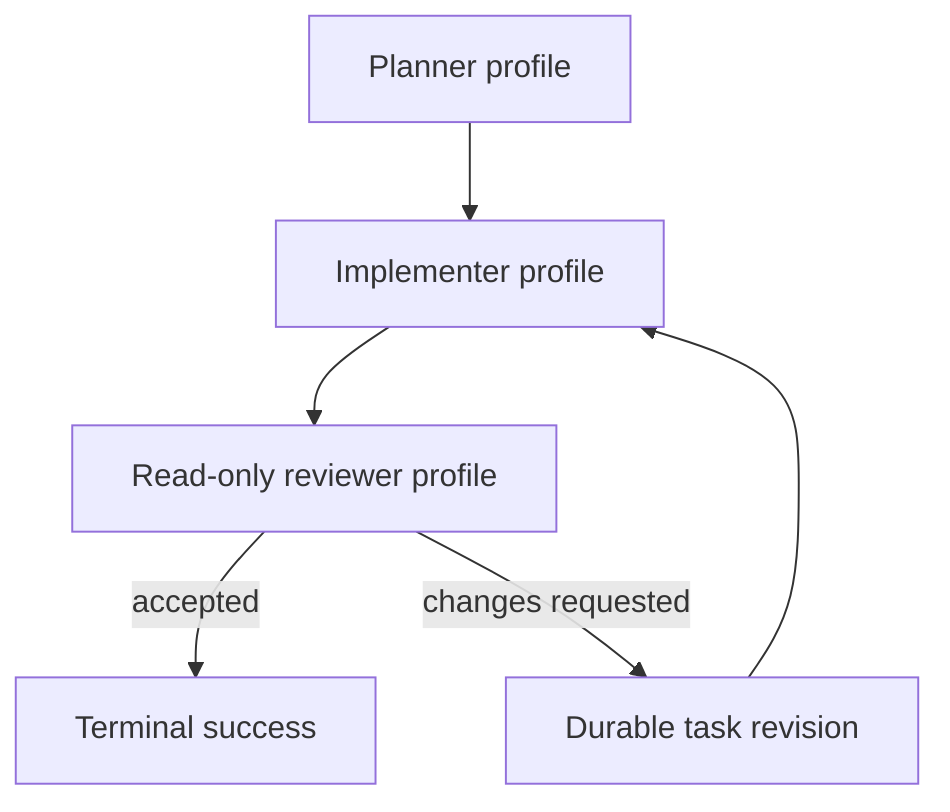

# Dogfood development pipeline plan

Status: **planned**

Last updated: 2026-11-10

Evidence baseline: `6b2ed6263efc8ec990dd6218c02b1434e702bf91`

## Purpose

Build a development pipeline that can safely work on `opencode-docker`, including
the orchestrator and pipeline definitions themselves. The pipeline must use
different execution profiles for planning, implementation and review, carry the
accepted run plan into the worker data plane, support real revision iterations,
and finish with the existing explicit Project Apply operation.

The current browser UI remains a diagnostic/operator surface until this pipeline
has completed a realistic dogfood UAT. UI design follows observed operator work;
it does not lead the backend work.

## Evidence from the proof-only audit

The proof-only audit at the evidence baseline established the following facts:

| Capability | As found |
| --- | --- |
| Different profile per agent state | Available |
| Different LLM server and model per profile | Available |
| Durable model/profile configuration identity | Missing; only the profile name is durable |
| Accepted task revision reaches the stage worker | Missing |
| Stage/plan/task/iteration context reaches the worker | Missing |
| Durable reviewer decision | Available |
| Operator-driven `continue-stage` / `revise-task` loop | Available |
| Automatic task-revision loop | Missing |
| Hard read-only reviewer workspace | Missing |
| General multi-task/multi-stage scheduler | Not ready |
| Pipeline definition frozen for an active run | Available |
| Profile definition frozen for an active run | Missing |
| Current browser UI can drive existing manual boundaries | Available, but diagnostic |

The decisive data-plane failure is that accepted plan and task revisions are
durable but worker-invisible. In the audit reproduction both stage activations
read the original protected pipeline input even after `revise-task`; the
`REVISION-ONE` and `REVISION-TWO` bodies existed only in run-plan manifests.

## Target topology



The first useful pipeline deliberately supports one active task in one stage.
General task scheduling and arbitrary stage DAG execution are later work.

## Architectural decisions

1. **Profiles are semantic pipeline references.** Pipeline states refer to
   `architect`, `code` and `review` profiles. Deployment configuration binds
   those profiles to worker images, OpenCode configuration, providers, models,
   servers and credentials. Pipeline documents do not contain server URLs,
   credential paths or secrets.

2. **The active run remains frozen.** Pipeline identity continues to be bound by
   the execution snapshot digest. Applying a change to pipeline source must not
   alter the active run.

3. **The development pipeline is separate.** Keep `pipelines/default-v2/` as a
   minimal smoke/reference bundle. Add a separate development bundle only after
   the required runtime contracts exist.

4. **Project Apply remains explicit.** A terminal run never updates the registered
   project automatically. Review and Apply remain separate operator decisions.

5. **Hard filesystem authority is required for review.** Prompt instructions or
   OpenCode permissions do not constitute a read-only boundary.

6. **No implicit task selection.** The first stage-task data source is valid only
   when the selected stage has exactly one task. Zero or multiple tasks fail
   closed before a worker Session. This increment must not grow into a scheduler.

7. **UI work is deferred.** Record UI defects and workflow friction during UAT,
   but do not redesign the UI before the development pipeline has been exercised.

## Ordered increments

| Order | Increment | Status |
| ---: | --- | --- |
| 1 | Durable stage activation context | Complete (b63c4cf; CI 42043441341) |
| 2 | Durable profile/model epoch | Complete (8e304bf; CI 42242433550 — build evidence, not test evidence) |
| 3 | Hard read-only reviewer | Complete (9863be3 + a37fe9f + 1fb634c; CI 42621186802; live UAT 2026-11-09) |
| 4 | Separate development pipeline bundle | Complete (3c7caa1; CI 42831456815 — build evidence; bundle contract proven by the permanent suite, no live UAT required) |
| 5 | Real dogfood UAT with revision and Apply | Planned |
| 6 | UI model and implementation based on UAT evidence | Planned |

Do not combine adjacent increments merely because they touch the same runner or
state schema. Each increment needs its own red-before evidence, contract,
permanent tests and delivery report.

## Increment 1: durable stage activation context

### Goal

Make the current accepted task revision and content-free orchestration identity
part of the exact worker-visible stage activation.

### Pipeline contract

Add one explicit data-port source form, provisionally:

```yaml
inputs:
  - id: task
    source:
      stage_task: {}
```

The final spelling may change during implementation if an existing source
vocabulary has a better fit, but the following semantics are fixed:

> Implementation note (2026-11-05): the provisional spelling
> `stage_task: {}` was kept; it is now a compiled source form of schema v2
> (`PipelinePortSourceStageTask`), valid only on an agent state whose compiled
> execution role is `stage`, with derived type `file`. The binding is durable:
> run-state schema v11 carries an optional `stage_task` field on agent
> executions (`task_id`, `task_revision`, `task_manifest_sha256`,
> `body_sha256`), recorded by `agent_data_prepared`. The schema bump was chosen
> because the worker-visible bytes digest had no durable anchor before this
> increment — the existing activation input binding proved only accepted
> outputs, not the stage-task input — so the durable-state rule below resolved
> to "schema bump required". The resolver is the single owner in
> `orchestrator/src/pipeline_v2_stage_task.ts`; failures carry the typed
> `stage_task_invalid` reason. Delivered in b63c4cf (CI run 42043441341);
> see the acceptance criteria below for the evidence mapping.

- valid only on an agent state whose trusted execution role is `stage`;
- the task is resolved only from the trusted accepted plan and current durable
  generation/stage context;
- no HTTP, UI, CLI or worker caller supplies a task ID, revision or path;
- the selected stage must contain exactly one task;
- zero tasks or multiple tasks produce a typed failure before Session creation;
- the worker-visible file is the exact UTF-8 byte encoding of the task revision's
  `body`, not the JSON task manifest;
- the input is published through the existing activation-data substrate and
  mounted read-only;
- the binding identifies at least task ID, task revision, task-manifest digest and
  digest of the exact worker-visible bytes;
- task body content does not enter `state.json`, public projections or
  diagnostics.

The execution document gains deterministic content-free orchestration metadata
sufficient to identify the activation:

- plan revision and plan digest;
- stage ID, position and template;
- task ID, revision and manifest digest;
- generation index;
- iteration index.

Previous results, reviewer feedback, profile identity, budget policy, reviewer
filesystem authority, Apply and UI are outside this increment.

### Durable-state rule

Reuse the existing immutable activation input binding if it can prove the exact
task revision and worker-visible bytes after restart. Add a versioned state field
and schema bump only if the existing durable substrate is insufficient. Do not
add duplicate digest or parser ownership merely to create a new schema version.

### Red-before

The permanent red-before must reproduce the observed production behavior:

1. task revision 1 contains `REVISION-ONE`;
2. the first stage activation receives the original pipeline input instead;
3. `revise-task` creates task revision 2 containing `REVISION-TWO`;
4. the next stage activation still receives the original pipeline input;
5. neither execution document contains stage/task/revision/iteration identity.

> Reproduced (2026-11-05) on baseline `68f902b` with a temporary harness that
> drove the real runner over a fake Docker Helper transport; both parts (the
> stale pipeline input on both stage activations, and the compile rejection of
> the new source form) were captured red before the implementation. The
> harness was removed after the permanent suites went green.

### Acceptance criteria

- before revision, the stage worker sees the exact bytes of
  `REVISION-ONE`;
- after `revise-task`, the next stage worker sees the exact bytes of
  `REVISION-TWO`;
- the selected task identity is recoverable and reverified after process restart;
- missing, substituted, non-canonical or digest-divergent task manifests fail
  before Session creation;
- missing or modified activation input artifacts fail closed;
- zero-task and multi-task stages fail before Session creation;
- a non-stage state cannot declare the source form;
- no caller-controlled filesystem path reaches the resolver;
- task bodies remain absent from durable state, public HTTP/UI documents,
  content-free errors and argv;
- existing pipeline-input and state-output source forms retain their behavior;
- no new event kind, UI surface, Apply behavior or profile-binding behavior is
  introduced.

Evidence (b63c4cf): the acceptance criteria are covered by the two permanent
suites — `orchestrator/tests/pipeline_v2_stage_task.test.ts` (compile and
resolver contract, binding mismatches, content-free diagnostics, WeakMap
isolation) and `orchestrator/tests/pipeline_v2_stage_task_runtime.test.ts`
(the real production runner and `revisePipelineV2Task` over a fake Docker
Helper transport: both stage activations receive the exact revision bytes,
the orchestration context appears in both execution documents without the
body, the durable binding is written exactly once per stage execution and
survives the restart boundary, multi-task and worker-tampered-input
refusals fail before any output acceptance, and the pre-Session
verification seam refuses deleted/modified/substituted artifacts). Local
`bun test` reports the apply/project-lock family as not run/not passed in
this environment (the libc-FFI metadata probe fails identically on the
clean baseline commit); CI build 42043441341 is the delivery evidence.

## Increment 2: durable profile/model epoch

Eliminate silent profile drift between separate mutating invocations.

The durable contract must bind a non-secret execution-profile epoch sufficient
to detect changes to the worker image and effective OpenCode/provider/model
configuration. Secrets and credential values remain outside durable state and
public documents.

Before implementation, choose and document whether the epoch is run-wide or
activation-specific. Either choice must make a post-restart execution's effective
profile identity provable and must reject silent substitution with a typed
failure. Explicit profile rebinding is not part of this increment unless
separately designed.

### Implementation note (2026-11-06): Complete as the durable run-wide profile epoch

The run-wide choice is implemented and documented (`AGENTS.md`, the durable
run-wide profile epoch bullet; `docs/orchestration-workflow.md`). One
`loadProfile` call per unique agent-state profile produces a deep-frozen
`ResolvedProfile` whose content-free identity projection builds the epoch
manifest (`pipeline-v2-profile-config\0`, `pipeline-v2-profile-env-value\0`
and `pipeline-v2-profile-epoch\0` digest domains; secrets never produce a
value digest, presence or length). The manifest is published once at
`<runRoot>/profile-epoch.json` and bound atomically into durable state
(schema v12, mandatory `profile_epoch {digest, profile_count}`). Every
mutating existing-run flow recomputes the epoch from the same loaded snapshot
the runtime factory receives and refuses drift with the typed
`profile_epoch_mismatch` before Launcher auth, Sessions, helper calls,
workers or any durable write. Secret rotation never changes the epoch;
profile rebinding and migrations stay out of scope. The plan was marked
complete only after the production commit `8e304bf` and its CI run
(`images`, success — build evidence, not test evidence).

## Increment 3: hard read-only reviewer

Add an OS-enforced read-only project workspace for reviewer activations while
leaving implementer activations read-write.

Required properties:

- the reviewer cannot modify the workspace through edit tools, shell,
  subprocesses, direct writes, rename/unlink or symlink tricks;
- Tool Session authority must not reintroduce write access;
- the policy is selected only by trusted compiled pipeline metadata;
- callers cannot request broader authority;
- direct write attempts are covered by runtime tests;
- prompt and OpenCode permission settings remain defense-in-depth only.

Do not combine this with reviewer decision semantics; durable agent outputs and
decision states already exist.

### Implementation note (2026-11-09): Complete as the compiled workspace access policy, live-UAT proven

Implemented and documented (`AGENTS.md`, the compiled orchestration metadata and
docker-helper runtime adapter bullets; `docs/orchestration-workflow.md`). A stage
role may declare `workspace_access: read_only` (closed vocabulary,
`pipeline_v2.ts`-owned; absence stays absence and compiles byte-identically);
`compiledWorkspaceAccessFor` is the single effective-policy owner with the single
`read_write` default site and is fail-closed on unknown/non-agent states. The
activation layout, execution document, Session filesystem policies and the worker
`POST /run` mount all report the compiled access; there is no read-only to
read-write fallback. Shipped as `9863be3`, corrected by `a37fe9f` (truthful
logical activation layout) and `1fb634c` (fail-closed resolver for
orchestration-less pipelines); CI run `42621186802` published the
`sha256:bddae3c6…ed75ce` orchestrator image.

Final live UAT (2026-11-09, report
`increment-3-final-uat-report.md` in the exchange outbox): the digest-pinned
orchestrator image ran the bundled-default-shaped UAT pipeline (stage role
declared read-only) through one `orchestrator run` to terminal success against
the real docker-helper 2.3.1 daemon with a real rotated Launcher credential and
real LLM workers (`local/glm53-flash`). Proven live: the Execution Session's
issued snapshot was run-root read-only with the activation outputs read-write
and the project read-only (subsumed by the run-root entry under the daemon's
documented normalization); the Tool Session carried exactly one entry — the
project — read-only, confirmed both by `session show` and by `GET /self` from
inside the worker; `/workspace` and `/pipeline/inputs` were kernel read-only
(bindfs `ro`, `docker_helper_ro_projection_t`) and `/pipeline/outputs`
read-write; a 13-probe write battery (create, overwrite, append, truncate,
read-write open, rename, unlink, mkdir, symlink, hardlink, chmod, and two
subprocess variants) was denied with `EROFS`/`EACCES` on every probe while the
project fingerprint stayed byte-identical; the reviewer's declared JSON output
was accepted through the existing digest/schema chain and published as the run
output; Tool-bearer escalation (`POST /run` with a read-write exposure of the
project) was refused `read_only_root` while the read-only control succeeded and
session management with a Session bearer stayed `unauthorized`; every
orchestrator-created Session was deleted (launcher session list empty after
cleanup) and all UAT trees, credential copies and sessions were removed.

## Increment 4: development pipeline bundle

Add a new bundle, provisionally `pipelines/development-v1/`, without expanding
`default-v2`.

Initial roles:

| State | Profile | Workspace |
| --- | --- | --- |
| Planner | `architect` | As required by the accepted planning contract |
| Implementer | `code` | Read-write |
| Reviewer | `review` | Hard read-only |

The first bundle uses one stage and one task. It must:

- consume the accepted task revision through the stage-task source;
- pass reviewer feedback through declared, digest-bound data ports;
- use the existing operator-driven `continue-stage` and `revise-task`
  controllers;
- reach terminal success only through reviewer acceptance;
- keep Project Apply explicit and post-terminal.

Automatic task rewriting, arbitrary task scheduling and multi-stage progression
remain out of scope.

### Implementation note (2026-11-10): Complete as the separate bundle `pipelines/development-v1/`

Shipped as `3c7caa1` (CI run `42831456815` published the
`sha256:14c7e86a…a42a` orchestrator image; the bundle ships through the existing
`pipelines/**` watch and wholesale `COPY` with no packaging change). The
implemented graph is `plan` (planning, `architect`) → `implement` (stage,
`code`, read-write, `stage_task` delivery) → `review` (stage, `review`,
read-only) → `review_gate` (deterministic decision, stage role) → accepted →
`done` / `changes_requested` → `relay` (stage, read-only, zero I/O) → `replan`
(planning, pointer-only proposal over the durable task ledger) → plan-ready
handoff → next iteration; reserved decision outcomes route to `failed`. The
relay correction is structural: a decision execution can never be the stage-wait
recognizer's last stage agent, so the changes-requested edge routes through a
dedicated stage-role relay agent whose `completed` transition enters the trusted
stage wait. Both planning roles declare `stage_wait {continue_stage,
revise_task}` and `plan_ready {stage_position: 1, initial_budget: 1}`: the fresh
`run` and a successful `orchestrator revise-task` each continue automatically
(plain `resume` is only the crash/restart path). The reviewer emits separate
`verdict`/`feedback` JSON ports — the evaluator validates the fact assignment
fail-closed, so a combined document is impossible — and the run output is the
required `review` JSON from `review.feedback`. The bundle declares only the
profile names `architect`/`code`/`review` and ships no profile definitions.

Contract proven by the permanent suite
`orchestrator/tests/pipeline_development_v1.test.ts` (15 tests through the
production loader and the production runner path over the deterministic
transport): loader/digest contracts (exact state graph, normalized orchestration,
exhaustive decision table, reserved-outcome routing through the engine resolver,
workspace-access matrix, digest sensitivity for the trusted policies, pinned
default-v2 byte-identity) and the full operator chain — accepted success
(revision 35), the changes-requested waiting boundary (revision 41),
`continue-stage` iteration 2 with unchanged task bytes (revision 68), one-command
`revise-task` with the revised stage-task bytes consumed by the next iteration
(revision 79), and both restart seams (a crash between the relay transition and
the wait entry; a revise-task interrupted inside the plan-ready continuation)
recovered by plain `orchestrator resume`. No live-LLM UAT is required for this
increment: the real-LLM behavior of the five prompts and the end-to-end
revise-and-Apply dogfood remain Increment 5's boundary.

## Increment 5: dogfood UAT

Run a real, moderately complex change against `opencode-docker`. The task should
touch production code, tests and documentation, but remain small enough for
manual inspection.

The UAT must traverse:

1. planning with the architect profile;
2. implementation with the code profile;
3. reviewer rejection or an intentional operator revision boundary;
4. a durable task revision;
5. a second implementation iteration that visibly consumes the revised task;
6. reviewer acceptance;
7. terminal success;
8. Project Changes and bounded content review;
9. explicit Project Apply;
10. restart and read-only recovery/inspection of the applied operation.

The scenario must guarantee a second iteration. A first-pass success is not
evidence that the revision loop works.

Capture:

- actual provider/model/profile identity per execution;
- exact task revision consumed by each iteration;
- reviewer filesystem authority;
- session cleanup;
- registered-project fingerprints before review and before Apply;
- UI actions that were unclear, missing or unnecessarily difficult.

## Increment 6: UI after dogfood

Design the operator UI from the dogfood workflow rather than extending the
current debug surface incrementally.

The UI model should be based on the observed primary operations:

- plan and task review;
- current stage/task/iteration identity;
- comparison between iterations;
- reviewer decision and feedback;
- explicit continue/revise actions;
- Project Changes/content review;
- explicit Apply and recovery state.

No UI contract is selected by this plan yet.

## Deferred work

The following are intentionally deferred until after the first development
pipeline UAT:

- multiple active tasks per stage;
- dependency scheduling;
- automatic progression across arbitrary stages;
- automatic task rewriting from reviewer output;
- automatic Apply;
- rollback;
- final-workspace sealing;
- broad UI redesign;
- migration to OpenCode V2.

## Drift-control rules

This file is the durable owner of the agreed ordering and scope.

- Update this document in the same commit that intentionally changes an
  increment's contract, ordering or status.
- Mark an increment complete only after its delivery commit, tests and CI result
  exist; add the commit SHA and evidence links to the status table.
- Implementation reports may refine evidence but must not silently expand the
  next increment.
- A later audit finding may change the plan, but the change must be explicit in
  this file before dependent implementation begins.
- Production documentation describes shipped behavior; this plan may describe
  future behavior and must remain clearly marked as such.
- Keep one production theme per increment and per commit.

## Open decisions

These are deliberately unresolved and must not be silently chosen by unrelated
work:

1. Whether reviewer feedback alone is sufficient for the next iteration or
   whether a separate operator-authored task revision is always required.
2. Multi-task scheduling semantics after the single-task dogfood pipeline.
3. The future UI information architecture.

Previously open and now resolved by their increments:

- Run-wide versus activation-specific durable profile epochs — resolved by
  Increment 2 (durable run-wide profile epoch, `8e304bf`).
- Exact schema spelling for trusted per-state workspace access — resolved by
  Increment 3 (optional stage-role `workspace_access: read_only | read_write`,
  `9863be3` + `a37fe9f` + `1fb634c`).
